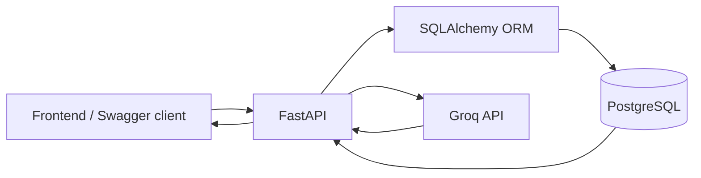
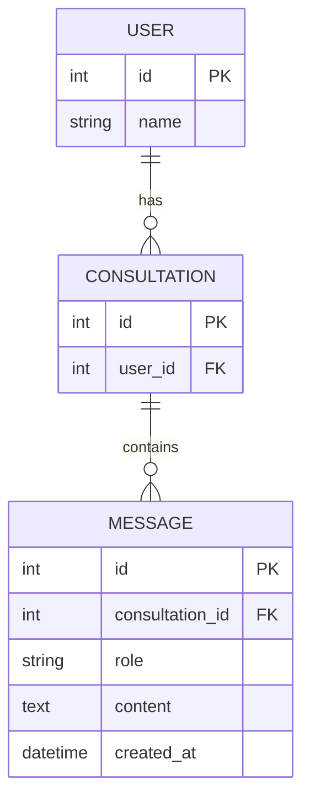
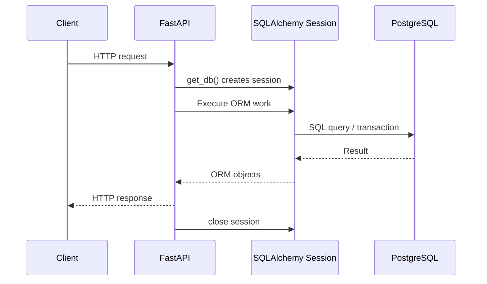
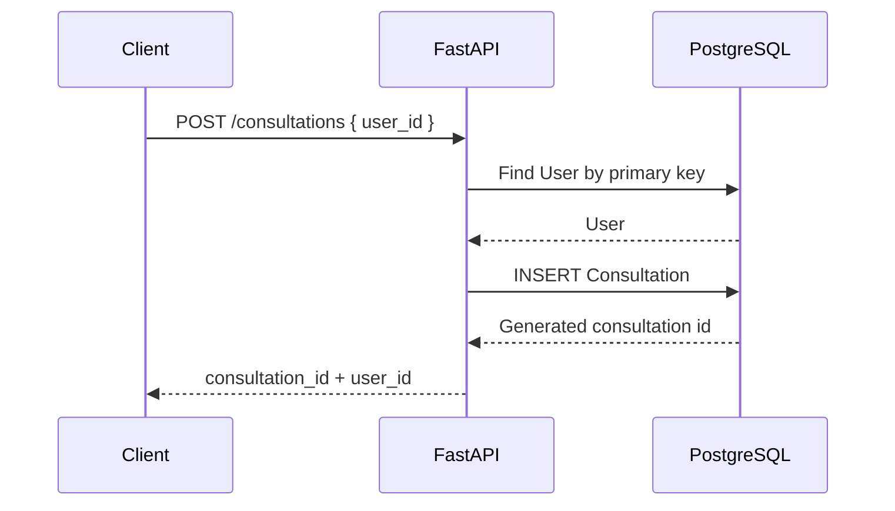
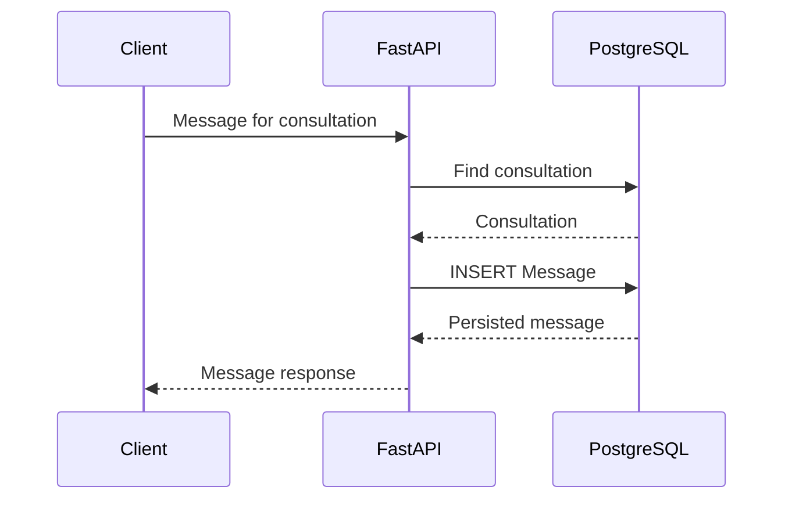
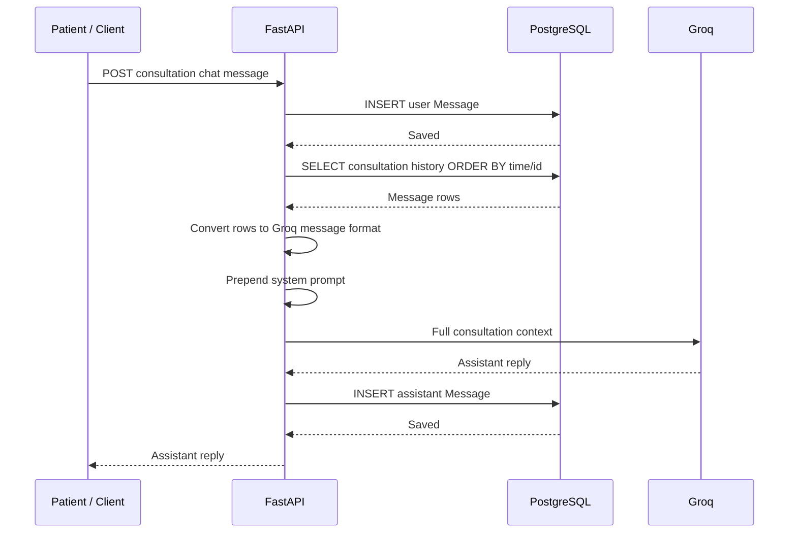
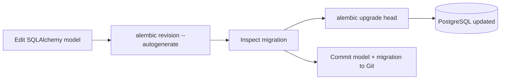
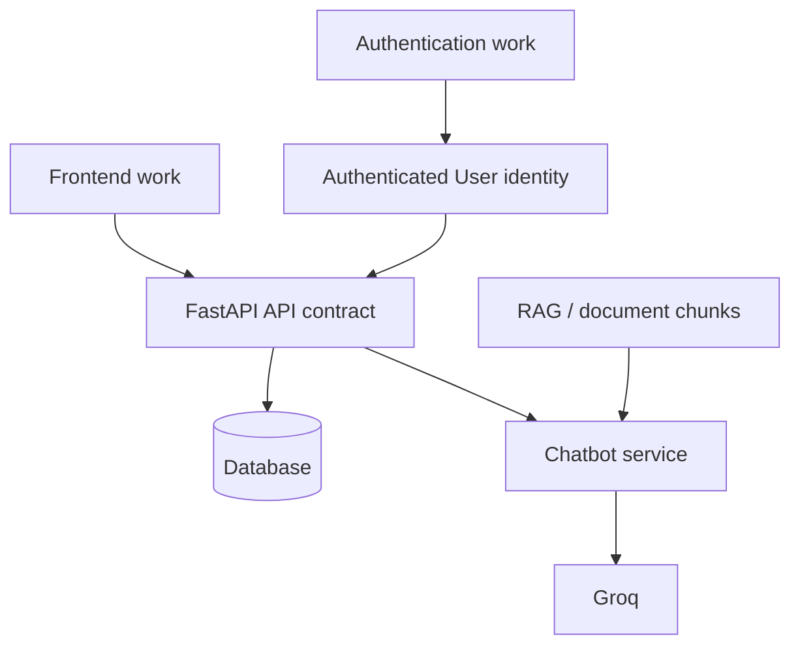

# GP Support Backend Architecture

This document describes the **current implemented backend**, not the final intended architecture.

## 1. Current components



### Responsibilities

- **FastAPI** receives requests and coordinates application behaviour.
- **Pydantic** validates request data.
- **SQLAlchemy** maps Python objects to relational database rows.
- **PostgreSQL** is the persistent source of truth for consultation history.
- **Alembic** tracks and applies database schema changes.
- **Groq** generates assistant responses from the consultation conversation history.

## 2. Current database model



### Relationships

- One `User` can have many `Consultation` records.
- Each `Consultation` belongs to one `User`.
- One `Consultation` can contain many `Message` records.
- Each `Message` belongs to one `Consultation`.

`Message` does not need its own `user_id` because the owning user can be found through:

```text
Message -> Consultation -> User
```

This avoids duplicating ownership information.

## 3. SQLAlchemy relationship model

The relational link exists through foreign keys in PostgreSQL:

```text
consultations.user_id -> users.id
messages.consultation_id -> consultations.id
```

SQLAlchemy `relationship()` / `back_populates` adds Python-side object navigation:

```text
user.consultations
consultation.user

consultation.messages
message.consultation
```

The relationship attributes are ORM conveniences; they are not additional database columns.

## 4. Database session lifecycle

FastAPI uses a request-scoped SQLAlchemy session through `get_db()`.



A global SQLAlchemy session should not be shared by all requests.

## 5. Creating a consultation

Current API concept:

```text
POST /consultations
```

Current prototype request includes a `user_id`. Authentication will eventually replace this with the identity of the authenticated user.



## 6. Persisting a message

Current API concept:

```text
POST /consultations/{consultation_id}/messages
```



The generic message endpoint is currently useful for testing. In the final chat API, the backend should determine whether a message has role `user` or `assistant`; the frontend should not be trusted to invent assistant messages.

## 7. Retrieving consultation history

Current API concept:

```text
GET /consultations/{consultation_id}/messages
```

Messages are filtered by `consultation_id` and ordered by:

```text
created_at, id
```

The ID acts as a deterministic tie-breaker if two messages receive the same timestamp.

Conceptual SQL:

```sql
SELECT *
FROM messages
WHERE consultation_id = :consultation_id
ORDER BY created_at, id;
```

## 8. Database-backed chatbot flow

The old prototype stored the entire conversation in one Python list. The current implementation instead reconstructs a specific consultation from PostgreSQL.



### Important consequence

PostgreSQL is now the **source of truth for conversation state**.

A FastAPI restart does not erase consultation history, and different consultations do not share one global conversation list.

## 9. Timestamp strategy

Message timestamps use timezone-aware UTC values in storage/application state.

Conceptually:

```text
Stored canonical instant: UTC
Human display: convert to local timezone, e.g. Pacific/Auckland
```

Example:

```text
UTC:              2026-08-17T20:59:50+00:00
Pacific/Auckland: 2026-08-18T08:59:50+12:00
```

The application should avoid hard-coding `+12:00` because New Zealand daylight-saving offsets change during the year.

## 10. Schema migration workflow

Alembic is now the source of truth for database schema evolution.



Do not use `drop_all()` for normal development schema changes.

Do not expect `Base.metadata.create_all()` to alter existing tables.

## 11. Current team integration boundaries

The backend is being developed so subsystems can meet at clear boundaries:



### Expected integration direction

- **Frontend** should depend on documented API endpoints, not database implementation details.
- **Authentication** should eventually resolve the authenticated identity to a real database `User`.
- **Chatbot logic** should receive conversation history and return a reply rather than owning persistent conversation storage itself.
- **RAG** should augment the chatbot context; it should not replace the consultation/message persistence model.
- **Database/backend architecture** remains the persistent source of truth and integration layer.

## 12. Next planned backend/database work

Likely next steps:

1. Add a persistent `Summary` model tied to a consultation.
2. Make summary generation consultation-specific.
3. Begin lightweight separation of routes, schemas, services, and prompts as responsibilities become stable.
4. Integrate authentication with the real `User` model.
5. Enforce consultation ownership after authentication is integrated.
6. Add appropriate indexes/constraints and review cascade behaviour.
7. Integrate RAG context at the chatbot-service boundary.

The project should continue to refactor incrementally rather than adopting a large opaque template.
